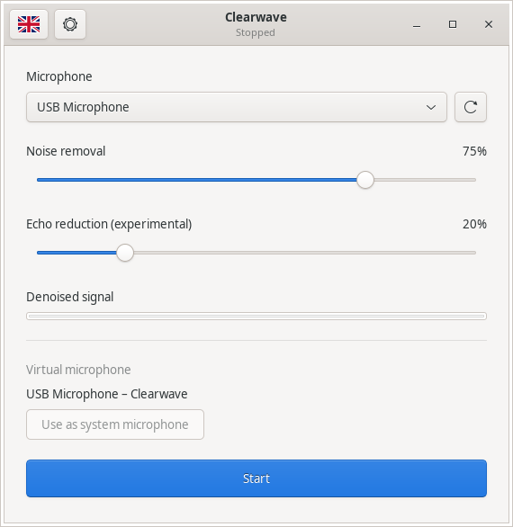

# Clearwave

**Experimental: native NVIDIA hardware equivalence and live-device latency remain unverified.**

Version **0.7.1-dev.4** corrects Broadcast 2.3's analysis window, causal feature
and spectrum alignment, nonlinear strength curve, and quiet-input conditioning.
Fourteen comparisons against the NVIDIA audio runtime on AMD pass the recorded
acceptance criteria. The remaining voice-band level difference is below 0.008 dB
in those cases. See [Broadcast comparison results](docs/BROADCAST_MODEL.md).
Version 0.6.6 corrected an output-projection layout error in earlier builds that
could suppress speech. Controlled comparisons with generated speech and two
natural speech references improve after the correction. Muffled speech and
residual static remain unresolved in a local microphone sample. CPU/GPU agreement
alone is not a speech-quality result.

Version 0.7.0 completes the supported feature graph mapping and
adds a native Windows interface with WASAPI audio. All 14 processing stages and
32 tensor layouts are explicit; reference input-level conditioning and vendor
output parity remain separate work. The legacy waveform adapter now retains three initial
recurrent-state updates that earlier builds skipped; this corrects startup
sequencing, with mixed measured speech-quality changes. See
[graph evidence](docs/MODEL_GRAPH.md) and [audio alignment](docs/AUDIO_ALIGNMENT.md).

## What is Clearwave?

Clearwave is an experimental effort to run RTX Voice and Broadcast audio models on AMD-based Linux and Windows systems and reduce microphone background noise in recordings and calls.
It processes audio locally using your AMD graphics card and provides a virtual microphone on Linux. On Windows, it sends processed audio to an output you choose; an installed virtual audio cable can expose that audio to your other apps.

## Why was it created?
NVIDIA’s noise reduction technology is impressive for recordings, but using it usually means having an NVIDIA setup.
Clearwave was created to bring the same model to AMD-based systems, without requiring NVIDIA drivers or running NVIDIA’s Windows application.


## Model files

For legal reasons, NVIDIA model files are not distributed with Clearwave.
Obtain **NVIDIA RTX Voice** or **NVIDIA Broadcast** separately to supply them; see
[NVIDIA’s RTX Voice setup and download guide](https://www.nvidia.com/en-us/geforce/guides/nvidia-rtx-voice-setup-guide/).
Clearwave supports RTX Voice **0.5.12.6** and the pinned noise-removal model used by
NVIDIA Broadcast **2.3.0.71988672**. Once exported, the weights run directly in
Clearwave’s Rust/WGSL engine; no NVIDIA DLL is needed for normal use. Broadcast
output agreement remains under validation; see [Broadcast model support](docs/BROADCAST_MODEL.md).
The installer, model packages, NVIDIA DLLs, and exported weights are excluded
from this repository and its releases. NVIDIA’s files remain subject to NVIDIA’s
license; Clearwave’s MIT license does not apply to them.

## License

Clearwave’s original source code is licensed under the [MIT License](LICENSE).
Third-party Rust dependencies and flag artwork retain their own licenses and
notices. Flag artwork attribution is in [ui/flags/LICENSE](ui/flags/LICENSE);
binary packages also include Rust dependency notices.

## Linux desktop interface



*The GTK3 interface with a dummy microphone selection; no personal devices are shown.*

```sh
./bin/clearwave
# Or select another bundle/settings file:
./bin/clearwave gui runtime/vendor --settings runtime/desktop.json
```

Choose a microphone, adjust **Noise removal**, and click **Start**.
Select the resulting `<original microphone> – Clearwave` input in your
recording or calling application. **Use as system microphone** explicitly changes
the system default; apps with a fixed input still need their own selection.
The window opens with capture stopped. Closing it stops its owned audio stream.

The small flag in the header switches between European Portuguese (Portugal),
Brazilian Portuguese (Brazil), Greek, Spanish, and English (United Kingdom).
The interface updates immediately and remembers the selection in desktop settings.
The country flags come from [flag-icons](https://github.com/lipis/flag-icons),
licensed under MIT. Their original SVGs and attribution are in `ui/flags/`;
`./bin/clearwave licenses` also displays the embedded copyright notice.
The settings button opens the model folder, AMD device, and buffer controls. While the folder picker is open, **Cancel** in Settings closes it; you can also enter the model folder path directly. Closing Clearwave stops its folder picker, including an unresponsive one. The model folder is detected from `runtime/vendor` beside the project.
Active settings are saved automatically to `runtime/desktop.json`. Microphone,
model, device, and buffer selection are locked while processing; strength changes apply without reconnecting
applications. The single signal bar reports denoised RMS in dBFS; hovering shows
its peak level.

The interface follows the installed GTK3 theme and uses a native folder chooser.
It requires GTK 3.24 or later and the GdkPixbuf SVG loader at runtime. It does not require a GUI OpenGL renderer.

## Windows desktop interface

The Windows frontend uses native controls through windows-rs, Windows fonts and
theming, per-monitor scaling, and a native folder picker. It preserves the same
Start/Stop controls, single denoised signal bar, five-language flag selector, and
automatically saved settings. Audio uses Windows WASAPI through CPAL.
The window uses native system colors, the language menu displays all five
choices, and the application name appears only in the title bar.

Choose a microphone and **Processed audio output**, then click **Start**. For use
in recording or calling apps, choose an installed virtual audio cable’s playback
endpoint as the output, then select its paired recording endpoint in those apps.
Clearwave does not install a Windows audio driver or change the system default.
Microphone and output must support 48 kHz PCM.

The model folder and settings persist at
`%LOCALAPPDATA%\Clearwave\runtime\desktop.json`. Device discovery and model/audio
processing stay off the UI thread. The folder picker runs in a cancellable owned
process, and closing the application terminates its owned workers.

Build with `./build.ps1` or `./clean_build.ps1` from a Visual Studio Developer
PowerShell; see [Windows requirements and routing](packaging/windows/BUILDING.md).
Windows hardware capture/playback and latency still require validation on a
physical Windows system.

## Debian, Ubuntu, and Linux Mint packages

[GitHub Releases](https://github.com/NullMagic2/Clearwave/releases) provides
model-free amd64 `.deb` packages for Debian 13, Ubuntu 24.04 LTS or newer, and
Linux Mint 22.x. The `releases/` folder contains the installation guide, manifest,
and checksums. Install
the matching file with `sudo apt install ./filename.deb`. Each package contains
the same executable linked against the Ubuntu 24.04 library baseline.

The installed app appears as **Clearwave** in the application menu. Settings
and optional local runtime assets use
`${XDG_DATA_HOME:-$HOME/.local/share}/clearwave/runtime/`. Choose a locally
supplied model folder in Settings. NVIDIA assets are excluded from every package.
Existing installed preferences under the previous application name are read when
Clearwave has no saved preferences yet, then saved under the new name.
The portable project build continues to use the project's own `runtime/` folder.
See `packaging/BUILDING.md` for reproducible package assembly and sysroot builds.

## Build

Linux requires Rust/Cargo 1.88+, a C linker, `pkg-config`, GTK3 development libraries,
and the dependencies in `Cargo.lock`. On Ubuntu, the GTK development package is
`libgtk-3-dev`.
The scripts use Cargo's offline mode so builds do not fetch or change dependencies.
On a new development machine, run `cargo fetch --locked` once first.

```sh
./build.sh
./bin/clearwave --help
./clean_build.sh
```

The clean build leaves only the executable in `bin/`; it preserves the source
project. Both scripts can be run from any working directory. `CARGO` can select a
different Cargo executable. Default output is a native Linux executable.

## Load the supplied model

In **Settings**, click **Installer…** and select either locally downloaded setup executable:

- NVIDIA RTX Voice **0.5.12.6**: its model bundle is extracted from the installer.
- NVIDIA Broadcast **2.3.0.71988672**: Clearwave reads the installer and looks for
  the supported audio files beside it, in a `Models` subfolder, or in NVIDIA’s
  local NGX model cache. If unavailable, it downloads about **33 MB** from NVIDIA.
  The Broadcast EXE itself does not contain its audio model.

Clearwave validates the files and graph, exports reusable weights in the background,
and saves the resulting model folder automatically. **Cancel** stops the selection
or import. The installer is read as an archive and is never run; install 7-Zip
(`7z` on PATH, or the usual Windows installation). The Broadcast download also
requires `curl` on Linux; supported Windows systems supply `curl.exe`.
Only the model and decoder data are retrieved; CUDA, TensorRT, cuBLAS, and FFT
libraries are not required by Clearwave.

Imported files stay locally under `runtime/imported-models/<installer SHA-256>`
using the application's runtime directory described above. Selecting the same
installer reuses its validated cache. You can also paste the installer path into
the model field; the audio worker imports it when you click **Start**. Existing
model folders and exported weights remain supported through **Browse…** or the
path field. NVIDIA assets are never added to Clearwave's releases.

For command-line import into a cache directory you choose:

```sh
./bin/clearwave import-model /path/to/RTX_Voice_Setup.exe /path/to/local-model-cache
```

For DLL-free use, put `voice-weights.safetensors` (or `model.safetensors`)
directly in your model folder and select that folder in Settings. No graph JSON
or DLL is needed. CLI commands also accept a `.safetensors` file directly.
The file must contain the supported denoising graph's 32 F32 tensors, as written
by Clearwave's `export` command; arbitrary neural networks are not supported.

If you use the original encrypted package instead, both files may be together
at the root of the selected folder:

```text
Models/
├── denoiser_48k.wpkg
└── NVAudioEffects.dll
```

For Broadcast, place `denoiser_48k.trtpkg` and `nvafxdenoiser.dll` together
at the root instead. Both package loaders read the DLL as data without executing it.

The original `NvAFX/models/denoiser_48k.wpkg` and
`NvAFX/nv/NVAudioEffects.dll` layout remains supported. Exported weights take
priority when present. An invalid export is reported as an error instead of
silently falling back to the DLL-dependent path.

To extract and export weights once from your own installer:

7-Zip is needed only for the initial archive extraction. The destination must be
new; vendor assets stay external to the executable.

```sh
mkdir -p runtime
./bin/clearwave extract \
  /path/to/NVIDIA_RTX_Voice_v0.5.12.6_Updated.exe runtime/vendor
./bin/clearwave inspect runtime/vendor
./bin/clearwave export runtime/vendor runtime/voice-weights.safetensors
./bin/clearwave inspect runtime/voice-weights.safetensors
```

The original file names, package payload, tensor names, and F32 values are
preserved. Exported tensors retain flat stored order; reshaping requires the
network's layer specification. The output path must not already exist.

## AMD execution

Requires an accessible AMD Vulkan hardware adapter and Vulkan userspace driver.

```sh
./bin/clearwave gpu-info
./bin/clearwave gpu-check runtime/vendor
./bin/clearwave gpu-check runtime/vendor '7900'
```

The matrix check executes nine real model matrices and compares every result with
an F64 CPU calculation. It refuses software/CPU adapters and reports the hardware.

## Feature-level network

```sh
./bin/clearwave graph runtime/vendor
./bin/clearwave operator-check runtime/vendor '7900'
./bin/clearwave infer-features runtime/vendor input.f32 gains.f32 '7900'
./bin/clearwave infer-features-cpu runtime/vendor input.f32 reference.f32
```

Input is a sequence of feature frames, each containing 320 little-endian F32
values. Output contains 961 raw F32 noise-mask values per input frame. These
commands accept model features; use the WAV commands below for waveform samples.

The complete supported graph has 14 explicit stages and validates all 32 stored
tensor layouts. Its implementation forms a seven-frame context, pads sequence boundaries with
zero feature values, and preserves four GRU states across frames. A new command
starts a new sequence with zero recurrent state. Output files must be new. If an
I/O or compute error interrupts a run, the partial output remains for inspection.

`operator-check` compares convolution, batch normalization, three activations,
GRU updates, and the connected feature graph against the CPU implementation. It
also checks state persistence and reset. CPU/AMD agreement does not establish
parity with NVIDIA's complete audio output. See `docs/MODEL_CONTRACT.md`.

## Process a recording

```sh
./bin/clearwave denoise runtime/vendor input.wav cleaned.wav 1.0 '7900'
./bin/clearwave denoise-cpu runtime/vendor input.wav reference.wav 1.0
./bin/clearwave wav-features input.wav features.f32
./bin/clearwave audio-bypass input.wav reconstructed.wav
```

The native WAV reader supports 48 kHz PCM16, PCM24, PCM32, and IEEE float32,
with one or two channels. Stereo is averaged to mono. Output is mono float32 WAV
with exactly the input sample count, including partial final hops. Existing files
are refused. Input files are limited to 64 MiB. Other sample rates and compressed
formats need conversion first, for example:

```sh
ffmpeg -i recording.flac -ar 48000 -ac 1 -c:a pcm_s16le input.wav
```

Strength defaults to 1.0, which applies `gain = 1 - noise_mask`; 0.0 gives unity
spectral gain. At intermediate settings, the strongest predicted-noise bins
retain full suppression while the remaining bins use
`gain = 1 - strength * noise_mask`. This implements the runtime's conditional
intensity rule, although agreement with the running NVIDIA application remains
unverified. The feature commands return the raw noise masks. See
[the model contract](docs/MODEL_CONTRACT.md) for the threshold calculation.

## Speech-quality evaluation

The 0.6.6 projection correction improves clean-reference voice levels and
noise separation in controlled comparisons, without adding output gain.
On two natural clean speech references, measured voice attenuation falls from
about 7 dB to less than 0.4 dB. These results do not establish quality for every
microphone, speaker, or noise environment, or equivalence to NVIDIA's output.

The reproducible local comparison tool accepts your own clean reference files:

```sh
python3 tools/benchmark_speech.py --binary bin/clearwave \
  --model /path/to/models --clean /path/to/clean-speech.wav \
  --output /path/to/new-comparison-directory
```

It requires Python 3, NumPy, and FFmpeg. The tool adds controlled static, hum,
and clicks, runs full-strength processing, and reports voice level, SI-SDR, and
noise after speech ends. Comparison audio stays in the specified local directory.
See [the correction and measurement notes](docs/OUTPUT_PROJECTION.md).

`wav-features` defaults to the legacy periodic Hamming window; its optional model
argument selects Broadcast’s periodic Hann window. Both use a 1,920-sample FFT, 480-sample hop,
and 320 area-normalized Slaney mel bands. Mel power is clipped between −40 and
48 dB and mapped to 0–1. Frame zero begins at sample −1,440; three tail frames
complete the overlap. Features outside the sequence are zero. Output is aligned
to input sample zero after inverse FFT and squared-window normalization.
See `docs/MODEL_CONTRACT.md` for the supported conventions and remaining parity
questions.

The CLI reports the actual adapter, execution mode, resident parameter bytes,
processing time, sample count, RMS levels,
and samples above full scale. It preserves float output without clipping or
automatic volume normalization. Lower output RMS alone does not prove speech
preservation or effective noise removal.

The AMD network keeps all 62,453,348 bytes of model parameters, recurrent states,
intermediate results, and bind groups resident on the GPU. Each feature step
uploads 8,960 bytes of context and reads back 3,844 bytes of mask data. GPU state
commits after successful output validation. The explicit CPU commands retain the
independent CPU path.

## Use the processed microphone across applications

Requires PipeWire/WirePlumber tools (`pw-dump`, `pw-loopback`, `pw-record`,
`pw-play`, `wpctl`), GNU `env`, and util-linux `setpriv`, alongside AMD Vulkan.

```sh
./bin/clearwave sources
./bin/clearwave live runtime/vendor \
  alsa_input.pci-0000_11_00.6.analog-stereo \
  --strength 1.0 --latency-ms 10 --adapter '7900'
```

Choose the exact source name, current object ID, or serial listed by `sources`.

### Optional echo reduction

The main window has an experimental **Echo reduction** slider below noise removal (0–100%). Leave it at 0%
to keep it off, or increase it gradually to reduce late room reflections. The
selection is saved and can change during processing. Higher values may alter
speech; this does not cancel speaker feedback. See
[echo reduction](docs/ECHO_REDUCTION.md) for behavior and offline comparisons.
